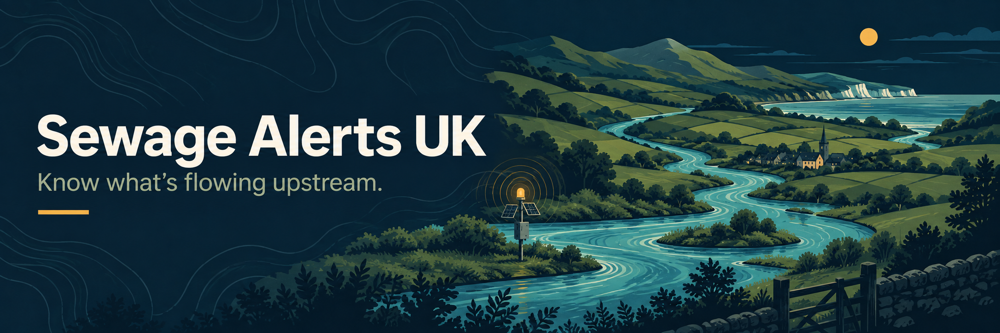

# Sewage Alerts UK

Get a Home Assistant alert when a water company reports a storm overflow upstream of your favourite river spot or near your local beach. You can also follow an individual outfall and show monitored sites on a dashboard map.

The integration checks nine English water-company feeds every 15 minutes. **Discharge reports cannot tell you whether water is safe to enter.** Follow local bathing-water advice.

## Installation

Requires **Home Assistant 2026.9.4 or later**. Sewage Alerts UK is currently available as a custom repository.

- **Home Assistant 2026.11 or newer** — Open **Settings → Marketplace → Add from link**. Enter `https://github.com/MrPsyware/HA-SewageAlertsUK`, connect GitHub if prompted, and select **Add**. Open **Sewage Alerts UK**, select **Install**, then restart Home Assistant.
- **Home Assistant 2026.9.4 through 2026.10** — In HACS, open **⋮ → Custom repositories**, enter the same URL and select **Integration**. Download **Sewage Alerts UK**, then restart Home Assistant.

Manual installation

Download the source ZIP from the [latest release](https://github.com/MrPsyware/HA-SewageAlertsUK/releases/latest). Copy the extracted `custom_components/sewage_alerts_uk` directory into your Home Assistant configuration directory so it contains `custom_components/sewage_alerts_uk/manifest.json`. Restart Home Assistant.

## Set up a watch

1. Go to **Settings → Devices & services → Add integration** and search for **Sewage Alerts UK**.
2. Choose your home location, a postcode, a town or village, or enter coordinates. For a particular beach or river bend, use coordinates for that spot.
3. Choose **River and upstream outfalls** to follow a mapped river section and its tributaries, or **Coastal area and beach outfalls** to search a circle around your point. Both default to 10 km and accept 1–25 km.
4. Choose how long the **Possible contamination** warning should stay on after a reported discharge ends. The default is four days (96 hours). Review the list of outfalls and confirm.

For one particular site, choose **Choose an individual outfall (advanced)** at the first step and search by company and river name or site ID. Add the integration again for another watch. To change a watch’s range, location, warning window or list of sites, remove that watch and set it up again.

## Get a discharge alert

In the automation editor, choose your watch’s **Upstream discharging** or **Coastal discharging** entity as a state trigger, set **To** to **On**, and choose a notification action. Leave **From** empty to catch a discharge first reported after a feed outage.

| Watch state | What it means |
| --- | --- |
| On | At least one monitored outfall reports a discharge. |
| Off | Every monitored outfall reports that it is currently inactive. |
| Unknown | Some reports are missing or offline and none confirms an active discharge. |

The watch also shows how many sites are active or unknown, when the latest discharge started, and its duration. **Possible contamination** stays on during a known discharge and for your chosen window afterwards. While a discharge is active its end time is unknown. [Dashboard maps and example automations](docs/dashboards.md)

## Coverage and privacy

Feeds cover Anglian Water, Northumbrian Water, Severn Trent Water, South West Water, Southern Water, Thames Water, United Utilities, Wessex Water and Yorkshire Water. Other UK providers are outside the current coverage. River watches can miss unmapped streams and exclude tidal sections and canals. Coastal watches include any outfall in the radius, including inland sites. Tides and currents can carry pollution across that boundary.

Postcode and town searches go to Postcodes.io during setup. Entering coordinates skips that lookup. Mapping services receive coordinates to find rivers and outfalls. A coastal watch created from a postcode or town can include that location in its device name. Keep this in mind when sharing dashboard screenshots.

## Support and development

[Report an issue](https://github.com/MrPsyware/HA-SewageAlertsUK/issues) · [Release notes](CHANGELOG.md) · [Developer guide and data sources](docs/development.md) · [Contributing](CONTRIBUTING.md)

Original code is available under the [MIT licence](LICENSE). Contains OS data © Crown copyright and database right 2026. Water-company and mapping data retain their respective licences. [Data credits](NOTICE)
